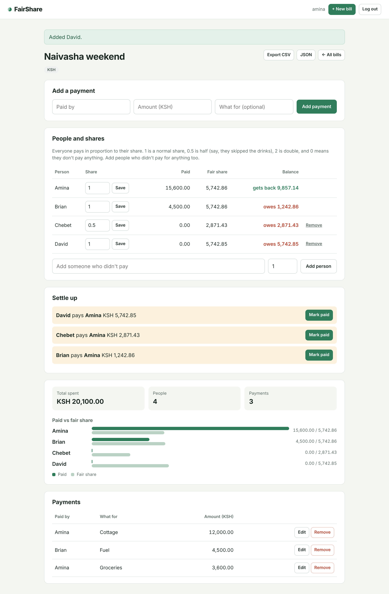
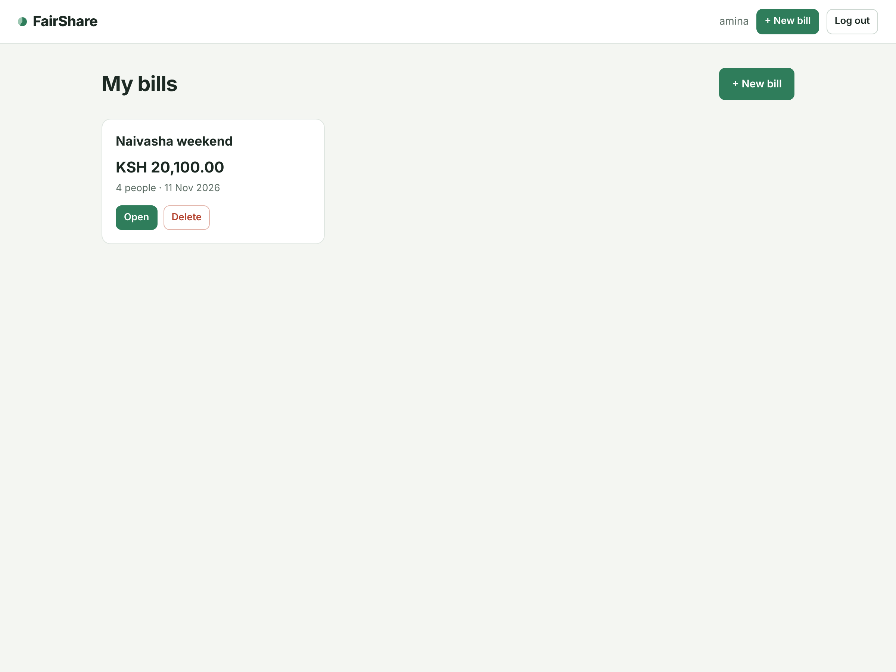
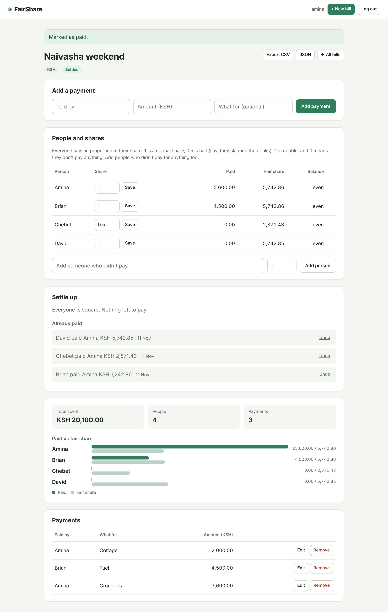
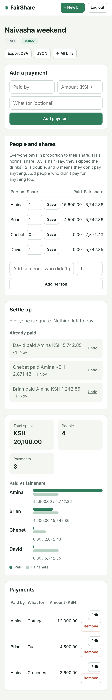

# FairShare


Split group expenses fairly, even when people shouldn't pay the same. Log who paid for what,
give each person a share (half for someone who skipped the drinks, double for a couple, zero for
someone who's covered), and FairShare works out who owes whom with as few transfers as possible.
As people pay each other back, mark each transfer as paid until the bill shows **Settled**.



## Features

- **Accounts:** register and log in; every bill is private to its owner (other users get "not found")
- **Bills** in KSH, USD, EUR, GBP, UGX or TZS
- **Payments** with who paid, how much and what for; edit or remove them any time
- **People who paid nothing** can be added too, so they still get their share of the cost
- **Uneven splits:** each person has a share weight (1, 0.5, 2, 0 …). Costs are split in proportion
- **Settle up:** a short list of "A pays B" transfers. **Mark paid** records each one; **Undo** reverses it. When nobody owes anything the bill is marked **Settled**
- **Exact money:** all maths is done in whole cents, and shares always add up to the exact total
- **Paid vs fair share** bar chart per person (plain HTML/CSS, no external scripts)
- **CSV export** (balances, payments, transfers still to pay and already paid) and a **JSON API** per bill

| Bills | Settled bill | Mobile |
|---|---|---|
|  |  |  |

## Tech stack

- **Backend:** Python 3.12, Flask, Flask-Login, Werkzeug password hashing
- **Database:** PostgreSQL (psycopg2), tables created automatically on start
- **Frontend:** server-rendered Jinja templates and plain CSS
- **Testing:** pytest against a real PostgreSQL database, GitHub Actions CI

## Project structure

```
fairshare/
├── app.py            # Flask app factory and routes (auth, bills, people, payments, settle up, export, API)
├── splitting.py      # Money maths: cents, weighted split, balances, suggested transfers (pure functions)
├── db.py             # Connection handling, schema and upgrade from the old one-name-per-payment format
├── templates/        # Jinja pages
├── static/style.css
├── tests/
│   ├── test_splitting.py   # Maths: rounding, weights, transfers always balance out
│   └── test_app.py         # Routes against Postgres: settle-up flow, ownership, validation, CSV, migration
├── requirements.txt / requirements-dev.txt
└── .github/workflows/tests.yml
```

## Setup (Windows / PowerShell)

You need Python 3.10+ and PostgreSQL.

```powershell
psql -U postgres -c "CREATE DATABASE fairshare"

python -m venv .venv
.\.venv\Scripts\Activate.ps1
pip install -r requirements-dev.txt
Copy-Item .env.example .env   # set SECRET_KEY and DATABASE_URL
python app.py
```

Open http://127.0.0.1:5000, create an account and start a bill. The tables are created on first start.

## Running the tests

```powershell
pytest
```

Without a test database, the 17 maths tests run and the 12 app tests are skipped. To run everything,
create a throwaway database (the tests wipe it) and point `TEST_DATABASE_URL` at it:

```powershell
psql -U postgres -c "CREATE DATABASE fairshare_test"
$env:TEST_DATABASE_URL = "postgresql://postgres:<password>@localhost:5432/fairshare_test"
pytest
```

CI runs the full suite against PostgreSQL 16 on every push and pull request.

## How it works

1. **Shares.** The bill total (in cents) is split in proportion to each person's weight using the
   *largest remainder* method: everyone gets the rounded-down amount, then the leftover cents go to
   the people whose exact share was cut the most. So 100.00 split three ways is 33.34 + 33.33 + 33.33,
   never 99.99.
2. **Balances.** Each person's balance is what they paid minus their fair share. Transfers already
   marked as paid move the amount from the payer's debt to the receiver's credit.
3. **Who pays whom.** Repeatedly, the person who owes most pays the person owed most. That needs at
   most *people − 1* transfers.
4. **Mark paid.** The button sends the transfer back to the server, which recalculates the current list
   and only records it if it still matches. A stale page (someone edited a payment in another tab)
   can't record a wrong amount.
5. **Ownership.** Every query for a bill also checks `user_id`, and anything that isn't yours returns
   "not found", so bill IDs can't be probed.

## Limitations

- One person manages each bill; friends can't log in and mark their own payments.
- No CSRF tokens on forms. The session cookie is `SameSite=Lax`, which blocks the usual cross-site form
  attack in modern browsers, but tokens would be the proper fix.
- The settle-up list keeps transfers few but isn't guaranteed to be the mathematical minimum.
- Everything in one currency per bill; no exchange rates.

## Future improvements

- Shared bills with invited members
- Per-payment splits ("only Amina and Brian had the taxi")
- M-Pesa payment links for each transfer
- CSRF protection with Flask-WTF

## License

MIT, see [LICENSE](LICENSE).
